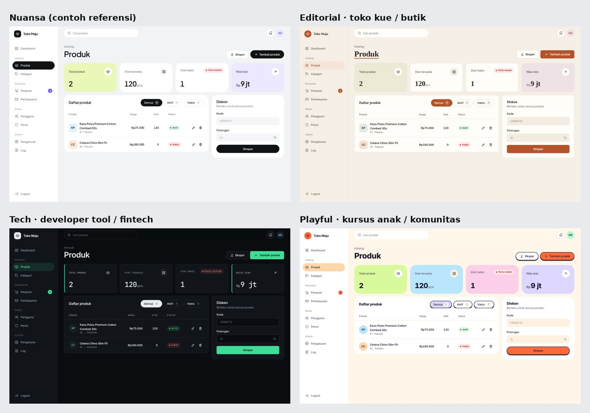

# Nuansa UI/UX Design — Claude Skill

Panduan desain UI/UX untuk Claude (Claude Code / Claude.ai) yang bisa dipakai untuk
**semua jenis website**, baik **membuat baru** maupun **merapikan yang sudah ada**.
Hasilnya **bersih, rapi, tidak kebanyakan teks, modern, responsive**, dan **mudah
diganti temanya**, tanpa merusak fitur yang sudah berjalan.

**Cocok untuk:** company profile, landing page/SaaS, toko online, blog/berita/dokumentasi,
portfolio, booking/jasa, kursus online, admin panel/dashboard, layanan publik/formulir,
halaman login, tool satu fungsi, dan web app mobile/PWA.

## Satu standar kualitas, wajah berbeda untuk tiap web

Skill ini menjaga **logika**: rapi, sejajar, sedikit teks, hierarki jelas, aksesibel,
responsive. **Tampilannya bebas dan kreatif**, mengikuti brand dan karakter masing-masing
web. "Nuansa" hanya contoh standar kualitas, bukan template yang ditiru. Buktinya, halaman
yang sama (HTML identik) bisa tampil dengan wajah yang sama sekali berbeda:



## Isi

```
nuansa-ui-ux-design/
├── SKILL.md                     # Alur kerja utama (5 fase) + prinsip desain
├── references/
│   ├── ux-flows.md              # Alur & struktur menu dulu: tugas utama, hitung langkah, sitemap, penamaan
│   ├── heuristics.md            # Evaluasi 10 heuristik Nielsen dengan skor 0–4
│   ├── states-and-edge-cases.md # Matriks state komponen, empty/error/loading, konten ekstrem
│   ├── accessibility.md         # WCAG 2.2 AA: cek otomatis + manual 10 menit
│   ├── performance.md           # Core Web Vitals: LCP, CLS, gambar, font, script
│   ├── design-direction.md      # Cara menentukan identitas visual unik per web + "sameness check"
│   ├── site-types.md            # Panduan per jenis web: halaman, komponen, kadar teks, preset
│   ├── audit-checklist.md       # Checklist audit per halaman + QA akhir
│   ├── design-tokens.md         # Template token (CSS vars / Tailwind / Bootstrap) + dark mode
│   ├── components.md            # Button, form, card, table responsif, modal, toast, chip pill, stat, dll.
│   ├── admin-panel.md           # Layout sidebar/topbar, grup menu, dashboard bento, tabel, filter
│   ├── style-presets.md         # 7 gaya: Clean Pro, Soft Bento, Mono + Accent, Status Pastel, Editorial Neutral, Soft Glass, Pastel Blocks
│   ├── layout-system.md         # Logika tata letak rapi: grid, garis sejajar, split header, ritme spacing, anatomi kartu
│   ├── landing-page.md          # Formula landing page: hero, stat strip, langkah, bento fitur + mini-demo, CTA, copywriting
│   ├── mobile-app.md            # Bottom nav, app bar, bottom sheet, onboarding, safe area
│   ├── theming.md               # Ganti warna seluruh web dari satu tempat + mode gelap
│   └── native-ui.md             # Hilangkan semua tampilan bawaan browser/Windows (popup, balon validasi, kontrol)
├── assets/
│   ├── starter/nuansa.css       # Mekanik siap pakai (layout, komponen, state) + 1 contoh skin; ganti skin per project
│   ├── examples/                # admin-produk.html (patokan kualitas, ?skin=editorial|tech|playful), skins.css, styleguide.html
│   ├── ui-feedback.js / .css    # Pengganti semua popup bawaan: alert/confirm/prompt, balon validasi, "Leave site?", tooltip
│   ├── ui-controls.css          # Checkbox, radio, select, file input, scrollbar, autofill ikut design system
│   └── theme.js / .css          # Engine tema runtime + panel pemilih warna (Theme.apply, Theme.mountPicker)
├── scripts/
│   ├── find_native_dialogs.py   # Cari semua alert/confirm/prompt di project
│   ├── style_audit.py           # Ukur kekacauan styling (warna, font-size, inline style, !important)
│   ├── responsive_check.js      # Screenshot 4 ukuran + overflow/tabrakan/meleset/kebanyakan teks + aksesibilitas (axe) + performa + stress test
│   ├── extract_design.js        # Pelajari design system web referensi dari URL-nya
│   ├── before_after.js          # Laporan sebelum/sesudah untuk klien (screenshot berdampingan + skor)
│   └── make_styleguide.py       # Halaman style guide otomatis dari token + CSS komponen
└── evals/                       # Test case (format `claude plugin eval`)
```

## Cara pakai

**Claude Code:** salin folder `nuansa-ui-ux-design/` ke `~/.claude/skills/` (untuk semua
project) atau `.claude/skills/` di project Anda. Lalu cukup minta, misalnya:

> Rapikan tampilan admin panel ini biar modern dan minimalis, responsive, dan ganti semua alert() jadi modal.

**Claude.ai:** upload file `.skill` hasil packaging di Settings → Capabilities → Skills.

Skill otomatis aktif untuk permintaan seperti "redesign", "rapikan tampilan", "biar tidak
jadul", "responsive", "ganti alert jadi modal", "bikin mirip referensi ini", atau "warna
web bisa diganti".

## Fitur utama

- **Prinsip utama: bersih, rapi, tidak kebanyakan teks.** Informasi dipindah dari kalimat ke angka, chip, badge, ikon,
  dan warna. Jumlah teks diukur otomatis (kata per layar, paragraf, tombol, judul).
- **UX dulu, baru visual**: tugas utama user, alur dengan jumlah langkah, sitemap, dan evaluasi heuristik Nielsen.
- **Kualitas terukur**: aksesibilitas WCAG 2.2 (axe-core), performa (LCP/CLS/TBT, `--slow`), stress test konten ekstrem (`--stress`).
- **Siap diserahkan ke klien**: laporan sebelum/sesudah otomatis dan halaman style guide.
- **Audit dulu, baru ubah**: inventaris fitur dibuat sebelum redesign agar tidak ada yang hilang.
- **Design tokens**: satu sumber untuk warna, spacing, radius, dan tipografi.
- **Gaya dari gambar referensi**: ekstrak spec gaya (warna, radius, tipografi, komponen khas) lalu dipetakan ke token.
- **Tema bisa diatur**: `Theme.apply({ primary: '#d4ff3a', mode: 'dark', radius: 'round' })`, dengan
  warna hover/soft/teks yang aman kontras dihitung otomatis.
- **Tanpa tampilan bawaan browser/Windows**: `UI.confirm()` berbasis Promise, `data-confirm` untuk link/form,
  pesan validasi inline otomatis (tanpa balon "Please fill out this field"), modal "Tinggalkan halaman?" untuk form
  yang belum disimpan, tooltip custom, dan kontrol form yang ikut gaya desain. Cek dengan `find_native_dialogs.py --all`.
- **Belajar dari web referensi**: `extract_design.js --url https://...` mengukur font, skala tipografi, palet, radius, tombol, urutan section, dan grid.
- **Tata letak rapi yang terukur**: aturan grid dan garis sejajar, plus deteksi elemen yang meleset 2–6px dari garis sejajarnya.
- **Verifikasi otomatis**: cek overflow, elemen bertabrakan, teks terpotong, touch target kecil di 375/768/1280/1440px.

## Uji cepat script

```bash
python nuansa-ui-ux-design/scripts/find_native_dialogs.py path/ke/project
python nuansa-ui-ux-design/scripts/style_audit.py path/ke/project
npm i -D axe-core   # opsional, untuk cek aksesibilitas
node   nuansa-ui-ux-design/scripts/responsive_check.js --url http://localhost:8000 --paths / /admin --stress --slow
node   nuansa-ui-ux-design/scripts/before_after.js --before ui-before --after ui-after --out ui-report
python nuansa-ui-ux-design/scripts/make_styleguide.py --tokens css/tokens.css --css css/components.css --out styleguide.html
```
